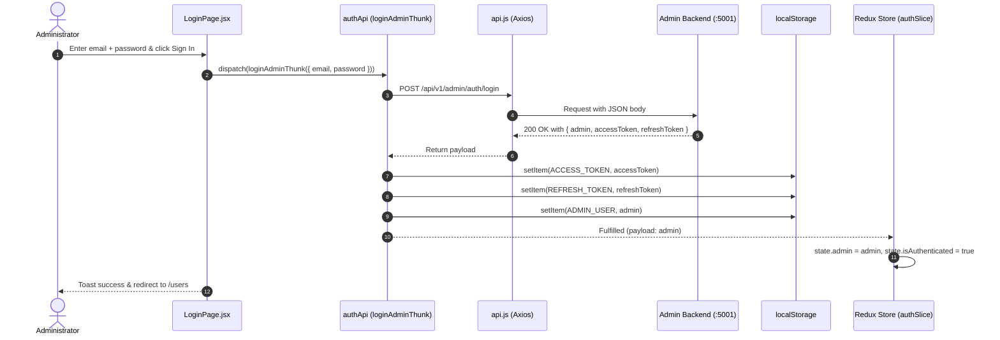

# Technical Requirements Document (TRD) — Japaika Admin Portal

> **Document Version:** 1.1.0  
> **Target Audience:** Admin Frontend Engineers, Full-Stack Developers, QA  
> **Scope:** `admin/` frontend workspace  
> **Backend Service:** Admin Backend (`admin-backend/`, default port `5001`)  
> **API Contracts Reference:** `shared/admin-api-contracts.md`  
> **Platform Standard:** React 19 + Vite + Tailwind CSS v4 + Redux Toolkit + Base UI Nova  

---

## 1. System Overview & Objectives

The **Japaika Admin Portal** is an enterprise-grade administration console designed to manage user identities, monitor Vedic birth chart bindings, adjust question and report credit allocations, enforce access controls, and oversee platform operations.

### Key Operational Goals
1. **Secure Administrator Authentication:** Credential-based authentication backed by the dedicated `admins` table (Email + Password, strict `role IN ('admin', 'super_admin')` verification, zero OTP dependencies).
2. **User Identity & Credit Control:** Centralized visibility over registered accounts, onboarding statuses, primary/secondary birth chart bindings, and instant account suspension/reactivation.
3. **Enterprise UI/UX Standard:** Modern dark-canvas obsidian aesthetic built with Tailwind CSS v4, Base UI Nova primitives, responsive navigation rail, and accessible data tables.
4. **Predictable State Architecture:** Asynchronous data handling powered by Redux Toolkit and Axios, ensuring tokens remain isolated in persistent storage and decoupled from application state trees.

---

## 2. Technology Stack & Tooling

| Category | Technology | Version | Rationale |
| :--- | :--- | :--- | :--- |
| **Runtime & Framework** | React (JavaScript) | `19.2.x` | Modern component model, high runtime efficiency |
| **Bundler & Dev Server** | Vite | `8.3.x` | Sub-second HMR, optimized production builds |
| **CSS & Design Engine** | Tailwind CSS v4 (`@tailwindcss/vite`) | `4.3.x` | Modern token system, zero-runtime overhead |
| **Component Primitives** | shadcn/ui (`@base-ui/react`, Nova preset) | `1.9.x` / `4.21.x` | Unstyled headless accessibility with Nova aesthetics |
| **State Management** | Redux Toolkit (`@reduxjs/toolkit`, `react-redux`) | `2.x` | Structured async slices via `createAsyncThunk` |
| **HTTP & API Client** | Axios | `1.20.x` | Interceptors for Bearer injection and 401 recovery |
| **Routing** | React Router DOM | `7.18.x` | Client-side routing with protected route guards |
| **Notifications** | Sonner | `2.0.x` | Toast notifications for async feedback |
| **Icons & Glyphs** | Lucide React | `1.57.x` | Consistent, accessible icon set |
| **Linter** | Oxlint | `1.81.x` | High-speed static code quality analysis |

---

## 3. Directory & File Architecture

The admin application follows a modular, feature-oriented structure inside `admin/src/`:

```text
admin/
├── public/                     # Static public assets (favicons, manifests)
├── src/
│   ├── app/                    # Global Redux configuration
│   │   └── store.js            # Central Redux store combining feature reducers
│   │
│   ├── components/             # Reusable presentation components
│   │   ├── layout/             # Application shell & structural components
│   │   │   ├── AdminLayout.jsx # Master frame (Sidebar + Header + Outlet container)
│   │   │   ├── Header.jsx      # Topbar (breadcrumbs, admin avatar, theme toggle, logout)
│   │   │   ├── Sidebar.jsx     # Responsive, collapsible left navigation rail
│   │   │   └── ProtectedRoute.jsx # Authentication route guard
│   │   ├── ui/                 # Headless shadcn/ui Base UI primitives
│   │   │   ├── avatar.jsx, badge.jsx, button.jsx, card.jsx
│   │   │   ├── dialog.jsx, dropdown-menu.jsx, input.jsx, label.jsx
│   │   │   └── separator.jsx, skeleton.jsx, switch.jsx, table.jsx, tabs.jsx
│   │   └── users/              # Feature-specific composite components
│   │       └── UserDetailsModal.jsx # Comprehensive user profile & birth details drawer
│   │
│   ├── features/               # Feature-based business logic & API thunks
│   │   ├── auth/               # Admin authentication module
│   │   │   ├── authApi.js      # createAsyncThunk calls (login, me, logout)
│   │   │   └── authSlice.js    # Auth state reducer (admin profile, loading states)
│   │   ├── theme/              # Color mode module
│   │   │   └── themeSlice.js   # Dark/light theme state & DOM synchronization
│   │   └── users/              # User management module
│   │       ├── usersApi.js     # User list, detail inspection, and block/unblock thunks
│   │       └── usersSlice.js   # User list, pagination, and detail state reducer
│   │
│   ├── lib/                    # Shared infrastructure & utilities
│   │   ├── api.js              # Axios instance with request/response interceptors
│   │   ├── constants.js        # API endpoints, storage keys, navigation registry
│   │   └── utils.js            # Tailwind cn class-merging helper (clsx + twMerge)
│   │
│   ├── pages/                  # Route-level page components
│   │   ├── DashboardPage.jsx   # Dashboard placeholder ('Coming Soon')
│   │   ├── LoginPage.jsx       # Email & Password authentication view
│   │   └── UsersPage.jsx       # User management data table, search & controls
│   │
│   ├── App.jsx                 # Route tree definition & toast providers
│   ├── index.css               # Global styles, Tailwind imports, Nova theme tokens
│   └── main.jsx                # Application root mounting with Redux Provider
│
├── components.json             # shadcn/ui Base UI Nova configuration
├── jsconfig.json               # Path alias mapping (@/* -> ./src/*)
├── package.json                # Project dependencies and script commands
├── TRD-admin.md                # This Technical Requirements Document
└── vite.config.js              # Vite bundler configuration
```

---

## 4. Authentication & Security Specification

### 4.1 Token Storage Policy (Strict Rule)
- **Zero Token Storage in Redux:** In accordance with platform security guidelines, authentication tokens (`accessToken`, `refreshToken`) must **NEVER** be persisted in the Redux store state tree.
- **Storage Mechanism:** Tokens are stored directly in browser `localStorage` using keys defined in [`src/lib/constants.js`](./src/lib/constants.js):
  - `japaika_admin_access_token`
  - `japaika_admin_refresh_token`
  - `japaika_admin_user` (cached administrator profile snapshot)
  - `japaika_admin_theme` (UI theme preference)

### 4.2 Authentication Flow (Email + Password)


### 4.3 Axios Interceptors Protocol
1. **Request Interceptor:**
   - Reads `localStorage.getItem(STORAGE_KEYS.ACCESS_TOKEN)`.
   - If present, injects header: `Authorization: Bearer <accessToken>`.
2. **Response Interceptor (401 Handling):**
   - If response status is `401 Unauthorized` on any protected route:
     - Clear `ACCESS_TOKEN`, `REFRESH_TOKEN`, and `ADMIN_USER` from `localStorage`.
     - Dispatch clean browser redirection to `/login`.
     - Suppress redirect loops when the failed request was already directed to `/auth/login`.

### 4.4 Route Guard (`ProtectedRoute.jsx`)
- Reads `isAuthenticated` and `isLoading` from `state.auth`.
- If `isLoading` is true (initial session hydration via `/auth/me`), renders a centered loading spinner.
- If `isAuthenticated` is false, redirects to `/login`, preserving `location.state.from` for post-login return routing.

---

## 5. API Interface Mapping (per `shared/admin-api-contracts.md`)

Base URL: `http://localhost:5001/api/v1/admin`

| Method | Endpoint | Access | Purpose | Request Body / Query | Success Response Data |
| :--- | :--- | :--- | :--- | :--- | :--- |
| `POST` | `/auth/login` | Public | Authenticates admin credentials | `{ email, password }` | `{ admin: { id, email, name, role, avatar_url }, accessToken, refreshToken }` |
| `GET` | `/auth/me` | Protected | Hydrates active admin session | None (Bearer header) | `{ admin: { id, email, name, role, avatar_url, created_at } }` |
| `GET` | `/users` | Protected | Lists users with pagination & search | `?page=1&limit=20&search=...` | `{ users: [...], pagination: { total, page, limit, totalPages } }` |
| `GET` | `/users/:id` | Protected | Fetches detailed profile + charts | None (`:id` param) | `{ user: { ..., birth_details: [...] } }` |
| `PATCH` | `/users/:id/status` | Protected | Suspends or unblocks user account | `{ is_blocked: boolean }` | `{ id, email, role, is_blocked }` |

> [!IMPORTANT]
> Raw horoscope data (`chart_data`, ~1MB JSON containing planetary houses and ephemeris cusps) is explicitly stripped by the backend on `GET /users/:id` to maintain sub-100ms API response times.

---

## 6. Feature Specifications

### 6.1 Administrator Login (`LoginPage.jsx`)
- **Route:** `/login`
- **Features:**
  - Auto-redirects to `/users` if administrator is already authenticated.
  - Interactive password visibility toggle (Eye/EyeOff icon).
  - Inline error alert banner on invalid credentials or account suspension (`401`, `403`).
  - Loading spinner indicator disabling form inputs during request in-flight.
  - Keyboard accessible (`Enter` key submission).

### 6.2 User Management (`UsersPage.jsx`)
- **Route:** `/users`
- **Features:**
  - **Debounced Search:** Automatically queries `search` against email with a 400ms debounce.
  - **Pagination Controls:** Previous/Next page navigation, total pages counter, rows-per-page selector (10, 20, 50).
  - **Data Table Presentation:**
    - User avatar badge with email address and verified icon indicator.
    - Role badge (`user` / `admin`) and color-coded Tier badge (`Free`, `Silver`, `Gold`, `Diamond`).
    - Jyotish question credits count and Artha Sutram report credits count.
    - Onboarding completion status (Complete vs Pending).
    - Account status badge (`Active` emerald vs `Blocked` rose).
    - Inline Switch toggle for immediate block/unblock action with optimistic state synchronization.
    - "Details" button triggering full user drawer/modal inspection.
  - **State Feedback:** Smooth skeleton rows during network requests and friendly empty state illustration when search finds no matches.

### 6.3 User Details Inspection (`UserDetailsModal.jsx`)
- **Component:** Accessible dialog modal triggered from the User Management table.
- **Features:**
  - Fetches fresh data via `GET /users/:id`.
  - **Account Overview Card:** Copyable UUID, creation timestamp, credit summary.
  - **Vedic Birth Details:** Lists all charts bound to the user profile, rendering Full Name, Gender, Birth Date & Time (with unknown time indicator), Coordinates, Timezone, and Primary Chart tag.
  - **Modal Action Footer:** One-click Suspend/Unblock account toggle with immediate Redux store cache update.

### 6.4 Dashboard Route (`DashboardPage.jsx`)
- **Route:** `/`
- **Status:** Empty placeholder ('Coming Soon'). No charts, statistics, or analytical queries are executed during Phase 1.

---

## 7. UI/UX Design System & Nova Tokens

The admin console leverages shadcn/ui configured with `@base-ui/react` and the **Nova** preset (`base-nova` in [`components.json`](./components.json)):

### Semantic Palette & Variables
- `--color-background`: Primary canvas (`#0F172A` in dark mode, neutral white in light mode).
- `--color-card`: Elevated surface for tables, modals, and login cards.
- `--color-primary`: Japaika celestial accent color.
- `--color-border`: 1px subtle separation borders for data tables and navigation rails.
- `--color-muted`: Low-contrast backgrounds for table headers and tag chips.

### Typography
- Primary Sans: `Geist Variable` (`@fontsource-variable/geist`).
- Monospace Numbers & IDs: System monospace / tabular figures for UUIDs, dates, and credit counters.

---

## 8. Development & Maintenance Runbook

### 8.1 Prerequisites
- Node.js v20+ or v22+
- Admin Backend service running on `http://localhost:5001`

### 8.2 Environment Configuration
Create a `.env` file in `admin/`:
```env
VITE_ADMIN_API_BASE_URL=http://localhost:5001/api/v1/admin
```

### 8.3 CLI Commands
```bash
# Install dependencies
npm install

# Start local development server (Port 5173)
npm run dev

# Run Oxlint static analysis
npm run lint

# Build production bundle with Vite
npm run build

# Preview production build locally
npm run preview
```
